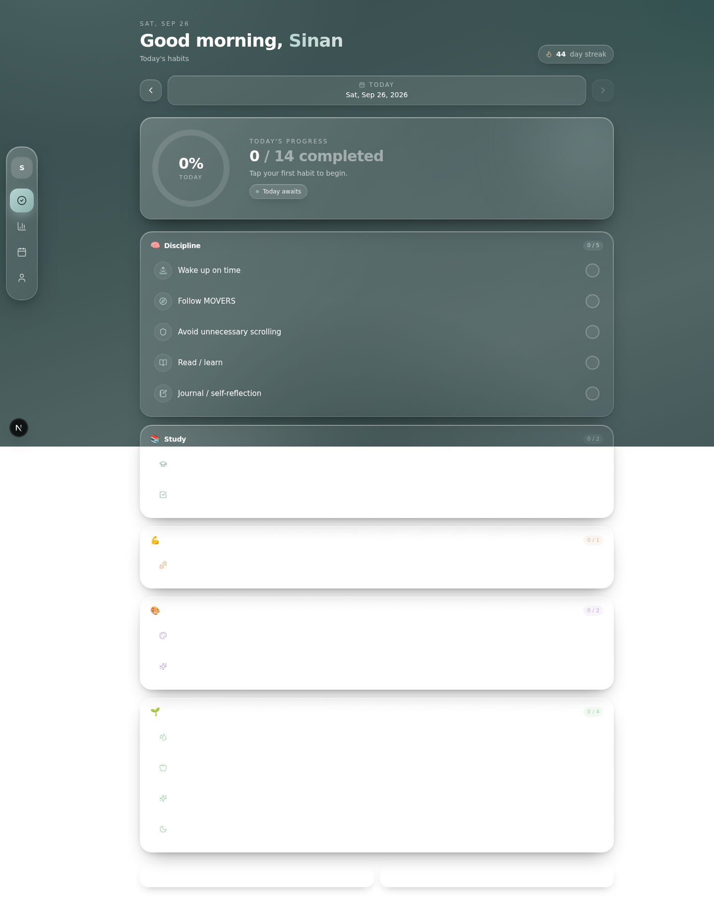
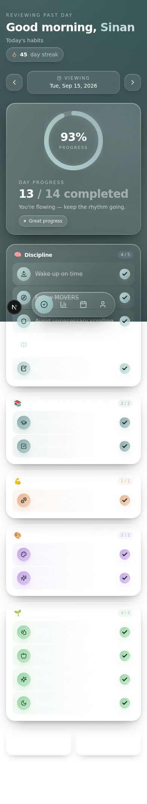
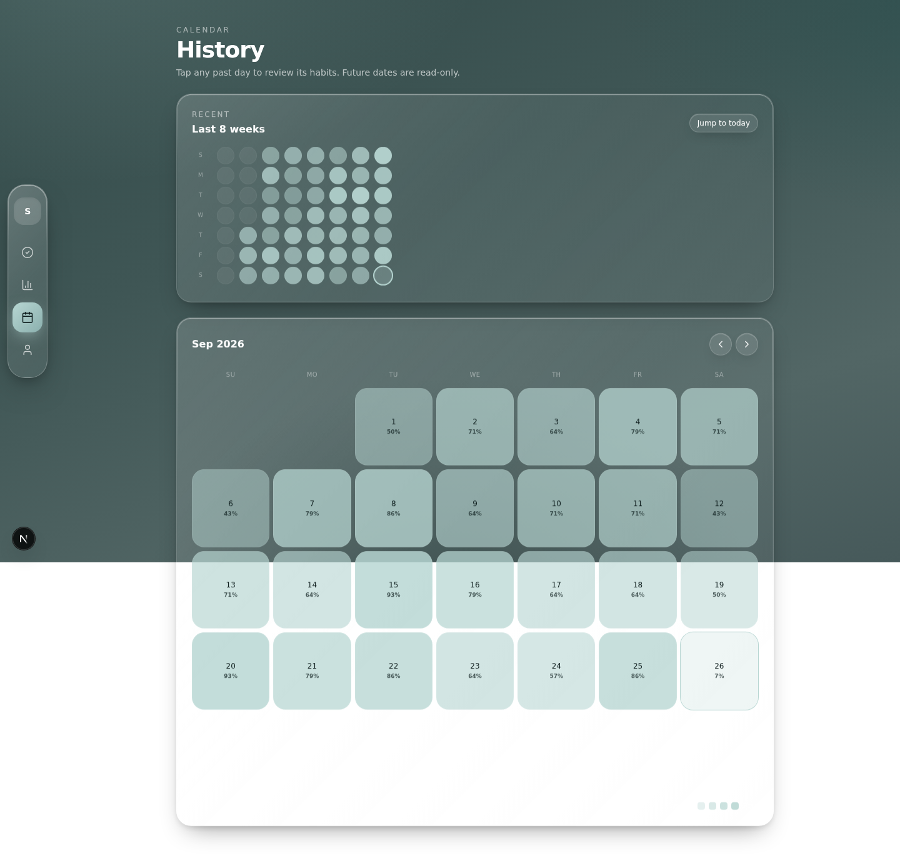
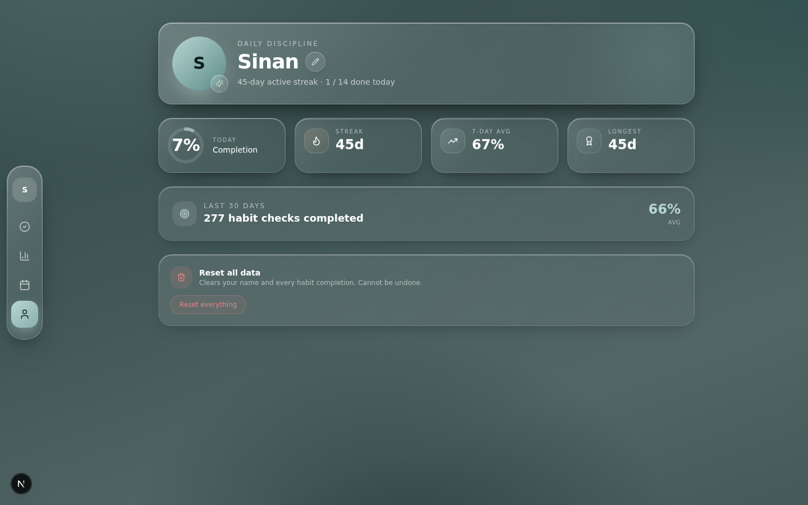

# Life OS Daily — Habit Tracker

A premium **glassmorphism** daily habit checklist. 14 fixed habits across 5 categories. One tap to check. Automatic progress tracking. Installable as a PWA on phone and laptop. Works fully offline.



## Features

### 🧠 14 fixed daily habits across 5 categories

| Category | Habits |
|---|---|
| 🧠 Discipline | Wake up on time · Follow MOVERS · Avoid unnecessary scrolling · Read / learn · Journal / self-reflection |
| 📚 Study | Daily study session · Complete planned tasks |
| 💪 Fitness | Exercise / workout |
| 🎨 Creative | Creative work · Personal project |
| 🌱 Personal | Drink enough water · Eat properly · Personal hygiene · Sleep on time |

No habit creation, editing, deleting, or customization. Just check them off every day.

### 📊 Today view

- Time-based greeting ("Good morning, Sinan")
- Date navigation (← prev · today · next →, future dates blocked)
- Prominent **Today's Progress** card with animated circular ring (X / 14 completed)
- Contextual status pill: "Today awaits" → "Good start" → "Keep going" → "Great progress" → "All done"
- 5 category sections, each with checkbox habit rows and smooth completion animations

### 📈 Progress view

- Daily snapshot with progress ring
- 4 stat cards: 7-day average, habits this week, current streak, longest streak
- Weekly rounded bar chart (last 7 days)
- Monthly smooth area chart (last 30 days)
- Per-category breakdown with progress bars

### 📅 History view

- 8-week mini heatmap (quick visual scan)
- Full month calendar with completion colors and percentages inside each day cell
- Click any past day to jump back to Today view at that date
- Month navigation (prev / next)

### 👤 Profile view

- Avatar with first initial
- Editable name (saved to localStorage)
- Today's progress mini-ring
- Streak / 7-day avg / longest streak stats
- 30-day total habit checks
- Reset all data button (with confirmation)

### 📲 PWA support

- **Installable** on Android (Chrome), iOS (Safari), Desktop (Chrome/Edge), macOS (Safari 17+)
- **Offline-capable** via service worker caching the app shell + static assets
- Custom app icons (192, 512, maskable, apple-touch-icon)
- Standalone display mode (no browser chrome when installed)
- Floating "Install Life OS" prompt on Chromium browsers (auto-dismisses for 7 days)
- `viewport-fit=cover` for iOS notch / safe area support

### 💾 Data persistence

All habit completions + user name are stored in browser **localStorage** under the key `life-os-daily-v1`. No backend, no accounts, no tracking — your data never leaves your device.

> **Note:** Each device's localStorage is independent, so a tracker installed on phone and laptop will have separate histories until you add a backend sync layer.

## Tech stack

- **Next.js 16** (App Router, Turbopack)
- **TypeScript 5**
- **Tailwind CSS 4** + **shadcn/ui** (New York style)
- **Framer Motion** for animations
- **Recharts** for charts
- **Zustand** + persist middleware for state
- **Lucide React** for icons
- PWA: vanilla service worker + Web App Manifest

## Project structure

```
.
├── public/
│   ├── manifest.json         # PWA manifest
│   ├── sw.js                 # Service worker (app-shell cache)
│   └── icons/                # PWA icons (192, 512, maskable, apple-touch, favicon)
├── src/
│   ├── app/
│   │   ├── layout.tsx        # PWA metadata + SW registration
│   │   ├── page.tsx          # App shell with view switching
│   │   └── globals.css       # Glassmorphism design system
│   ├── components/
│   │   ├── ui/                # shadcn/ui primitives
│   │   └── lifeos/
│   │       ├── today-view.tsx
│   │       ├── progress-view.tsx
│   │       ├── history-view.tsx
│   │       ├── profile-view.tsx
│   │       ├── floating-nav.tsx
│   │       ├── habit-row.tsx
│   │       ├── today-progress-card.tsx
│   │       ├── date-navigator.tsx
│   │       ├── progress-ring.tsx
│   │       ├── glass-card.tsx
│   │       ├── reset-button.tsx
│   │       ├── install-prompt.tsx
│   │       └── sw-register.tsx
│   └── lib/
│       ├── lifeos.ts         # 14 fixed habits + date + calculation logic
│       └── store.ts          # Zustand store with localStorage persistence
├── docs/screenshots/         # Screenshots for this README
├── scripts/
│   └── generate-pwa-icons.py  # Regenerate PWA icons from scratch
├── prisma/schema.prisma      # (optional, unused in PWA mode)
├── next.config.ts            # Headers for /sw.js and /manifest.json
└── package.json
```

## Getting started (local dev)

### Prerequisites

- **Node.js 18+** or **Bun**
- A modern browser

### Install & run

```bash
# 1. Clone the repo
git clone https://github.com/YOUR_USERNAME/life-os-daily.git
cd life-os-daily

# 2. Install dependencies
bun install
# or: npm install

# 3. (Optional) Set up the local database path
cp .env.example .env
mkdir -p db

# 4. Run the dev server
bun run dev
# or: npm run dev
```

Open [http://localhost:3000](http://localhost:3000) in your browser.

### Verify the PWA works

After the dev server is running:

1. Open Chrome DevTools → Application → Manifest — you should see the manifest with name "Life OS Daily"
2. Application → Service Workers — you should see `sw.js` activated and running
3. Application → Cache Storage — you should see `lifeos-static-*`, `lifeos-page-*`, `lifeos-runtime-*` caches
4. To test offline: open DevTools → Network → check "Offline" → reload the page — the app should still work

## Building for production

```bash
# Build the standalone server bundle
bun run build

# Start the production server
bun run start
```

The build outputs to `.next/standalone/` and includes a self-contained Node server.

## Deployment

The PWA is just a Next.js app — deploy anywhere that supports Node:

### Vercel (recommended)

1. Push your repo to GitHub
2. Go to [vercel.com](https://vercel.com) → "New Project" → import your repo
3. Vercel auto-detects Next.js → click "Deploy"
4. Your PWA is live on `https://your-project.vercel.app`

### Netlify

1. Push to GitHub
2. [netlify.com](https://netlify.com) → "Add new site" → "Import an existing project"
3. Build command: `npm run build` · Publish directory: `.next`
4. Deploy

### Self-host (VPS / Docker / bare metal)

```bash
bun run build
NODE_ENV=production bun .next/standalone/server.js
```

Then put a reverse proxy (Nginx, Caddy) in front of it. Make sure to serve over **HTTPS** — service workers and PWA install prompts require HTTPS (localhost is exempt).

### Cloudflare Pages / Render / Railway

Follow their Next.js deployment guides — they all work out of the box.

## Installing as a PWA

Once your deployment is live over HTTPS:

| Platform | How to install |
|---|---|
| **Android (Chrome)** | Visit URL → ⋮ menu → "Install app" |
| **iOS (Safari)** | Visit URL → Share ⬆️ → "Add to Home Screen" |
| **Desktop (Chrome/Edge)** | Click ⊕ install icon in the address bar |
| **macOS (Safari 17+)** | File → "Add to Dock" |

After installation, the app launches in standalone mode (no browser chrome), works offline, and behaves like a native app.

## Customizing the habits

The 14 habits are hardcoded in [`src/lib/lifeos.ts`](src/lib/lifeos.ts) — look for the `FIXED_HABITS` array. Edit the array to change names, icons, or categories. Available icon names are listed in [`src/components/lifeos/habit-icon.tsx`](src/components/lifeos/habit-icon.tsx) (imported from `lucide-react`).

After editing, the seed history stays empty — users will start fresh from today.

## Regenerating PWA icons

If you change the brand color or letter, regenerate icons:

```bash
python3 scripts/generate-pwa-icons.py
```

Requires Python 3 with Pillow (`pip install pillow`). Output goes to `public/icons/`.

## Screenshots

| Today (desktop) | Today (mobile) |
|---|---|
|  |  |

| History | Profile |
|---|---|
|  |  |

## License

MIT — see [LICENSE](LICENSE). Free to use, modify, and distribute.

---

Built with care for people who want to show up for their habits every day.
